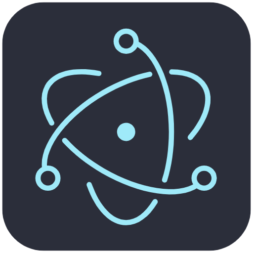

<div align="center">
  
  <h1>🤖 Botticelli</h1>
  <p><strong>An environment to configure and deploy conversational agents</strong></p>
  
  [](https://opensource.org/licenses/AGPL-3.0)
  [](https://www.typescriptlang.org/)
  [](https://reactjs.org/)
  [](https://www.electronjs.org/)
</div>

---

## 📖 About Botticelli

Botticelli is a sophisticated desktop application built with Electron, React, and TypeScript that provides a comprehensive environment for configuring, managing, and deploying conversational agents. Whether you're conducting research experiments, building AI assistants, or creating interactive simulations, Botticelli offers the tools you need to bring your conversational AI projects to life.

### ✨ Key Features

- **🤖 Multi-Agent Management**: Create and manage both artificial and human agents
- **🧪 Experiment Framework**: Design and run controlled experiments with multiple participants
- **💬 Interactive Conversations**: Real-time messaging and conversation management
- **🎯 Template System**: Reusable interaction and exchange templates
- **🎙️ Audio Support**: Voice transcription and audio message handling
- **🌍 Internationalization**: Multi-language support (English, French)
- **📊 Simulation Tools**: Create and run agent simulations
- **⚡ Trigger System**: Automated event-driven interactions
- **🔧 Settings Management**: Comprehensive configuration options

### 🏗️ Architecture

Botticelli is built with a modern tech stack:

- **Frontend**: React 18 with TypeScript, Material-UI Joy components
- **Backend**: Electron main process with TypeORM for data persistence
- **Database**: SQLite for local data storage
- **State Management**: Redux Toolkit with persistence
- **Audio Processing**: FFmpeg integration for audio handling
- **AI Integration**: OpenAI API support for AI-powered responses

## 🚀 Getting Started

### Prerequisites

- **Node.js** (v18 or higher)
- **Yarn** (v4.1.1 or higher)
- **Git**

### Installation

1. **Clone the repository**
   ```bash
   git clone https://github.com/juancarlosfarah/botticelli.git
   cd botticelli
   ```

2. **Install dependencies**
   ```bash
   yarn install
   ```

3. **Start the development server**
   ```bash
   yarn dev
   ```

The application will open in a new Electron window. You'll be prompted to log in to access the main interface.

### 🛠️ Development

#### Available Scripts

```bash
# Development
yarn dev              # Start development server
yarn start            # Start production preview

# Building
yarn build            # Build for current platform
yarn build:win        # Build for Windows
yarn build:mac        # Build for macOS
yarn build:linux      # Build for Linux

# Code Quality
yarn lint             # Run ESLint
yarn format           # Format code with Prettier
yarn typecheck        # Run TypeScript type checking
```

#### Recommended IDE Setup

- [VSCode](https://code.visualstudio.com/) with the following extensions:
  - [ESLint](https://marketplace.visualstudio.com/items?itemName=dbaeumer.vscode-eslint)
  - [Prettier](https://marketplace.visualstudio.com/items?itemName=esbenp.prettier-vscode)
  - [TypeScript](https://marketplace.visualstudio.com/items?itemName=ms-vscode.vscode-typescript-next)

## 📁 Project Structure

```
botticelli/
├── src/
│   ├── main/                 # Electron main process
│   │   ├── channels/         # IPC communication channels
│   │   ├── entity/           # TypeORM database entities
│   │   └── utils/            # Main process utilities
│   ├── renderer/             # React frontend application
│   │   └── src/
│   │       ├── components/   # React components
│   │       ├── services/     # API services
│   │       └── store/        # Redux store
│   └── shared/               # Shared types and interfaces
├── resources/                # Application resources
└── config/                   # Build configuration
```

## 🎯 Core Concepts

### Agents
- **Artificial Agents**: AI-powered assistants, evaluators, and participants
- **Human Agents**: Human assistants and participants
- **Agent Types**: Different roles and capabilities for various use cases

### Experiments
- **Interaction Templates**: Reusable conversation patterns
- **Exchange Templates**: Structured conversation flows
- **Participant Management**: Assign agents to experiments

### Interactions
- **Real-time Messaging**: Live conversation capabilities
- **Audio Support**: Voice transcription and playback
- **Message History**: Persistent conversation storage

## 🤝 Contributing

We welcome contributions from the community! Here's how you can help:

### 🐛 Reporting Bugs
- Use the [GitHub Issues](https://github.com/juancarlosfarah/botticelli/issues) page
- Include detailed steps to reproduce the issue
- Provide system information and error logs

### 💡 Suggesting Features
- Open a new issue with the "enhancement" label
- Describe the feature and its potential benefits
- Consider implementation complexity and impact

### 🔧 Pull Requests
1. Fork the repository
2. Create a feature branch (`git checkout -b feature/amazing-feature`)
3. Make your changes
4. Run tests and ensure code quality (`yarn lint && yarn typecheck`)
5. Commit your changes (`git commit -m 'Add amazing feature'`)
6. Push to the branch (`git push origin feature/amazing-feature`)
7. Open a Pull Request

### 📋 Development Guidelines
- Follow the existing code style and conventions
- Write meaningful commit messages
- Add tests for new features
- Update documentation as needed
- Ensure all TypeScript types are properly defined

## 📄 License

This project is licensed under the GNU Affero General Public License v3.0 - see the [LICENSE](LICENSE) file for details.

## 👥 Contributors

### Maintainers
- **Juan Carlos Farah** - [juancarlosfarah](https://github.com/juancarlosfarah)

### Contributors
<!-- Add contributors here as they contribute to the project -->

---

<div align="center">
  <p>Made with ❤️ and ☕️ in 🇨🇭.</p>
  <p>If you find Botticelli useful, please consider giving it a ⭐ on GitHub!</p>
</div>
